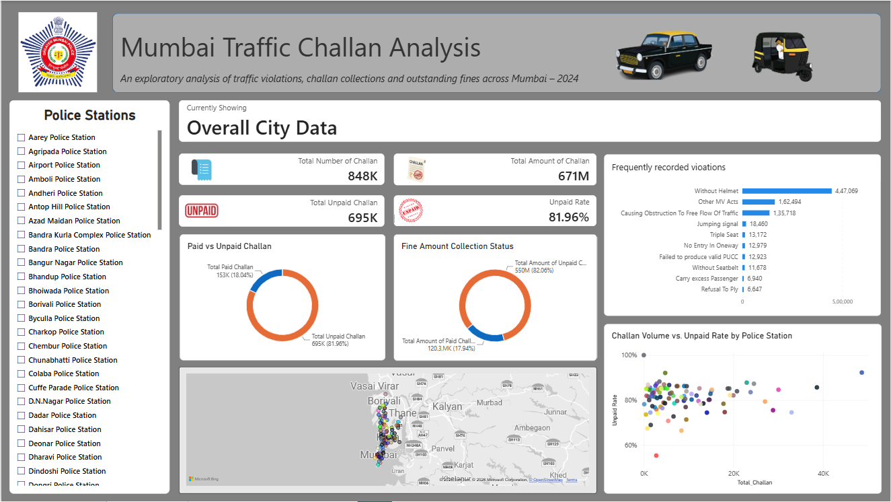
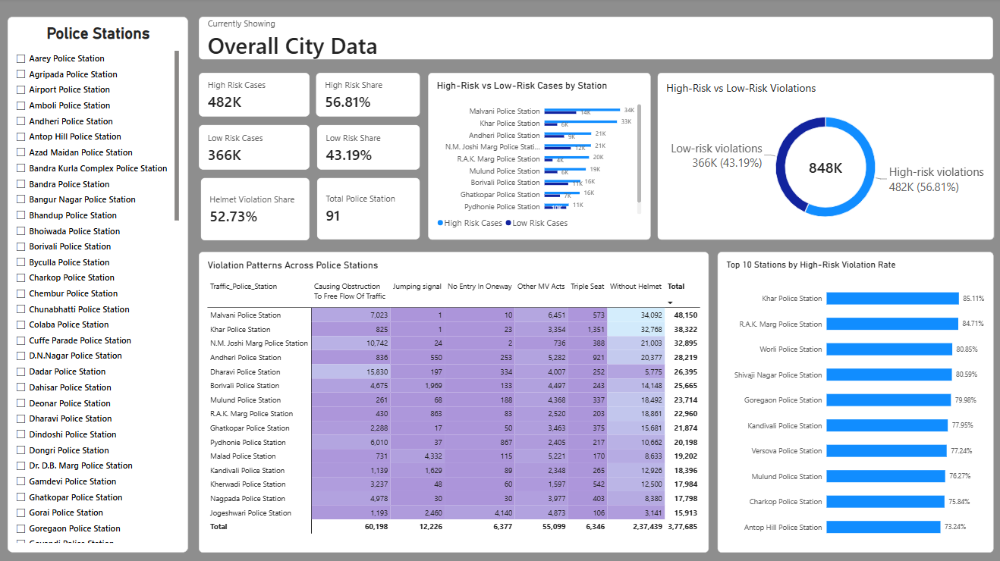

# Mumbai Traffic Challan Analysis (2024)

An end-to-end analysis of 2024 traffic challan and violation data across 91 Mumbai police stations: how much of the fine money is actually collected, and what kinds of violations are being enforced. Built with Python (Pandas), SQL (SQLite) and Power BI.

> **Disclaimer:** This is an independent analysis of publicly available data. It is not affiliated with or endorsed by the Mumbai Traffic Police.

---

## Highlights

- **82% of fines go unpaid.** 695K of 848K challans, and about ₹55 crore of ₹67.1 crore in fines, were unpaid. The rate stays high at stations of every size.
- **Fine size does not explain non-payment.** The average unpaid fine (₹792) is almost the same as the average paid fine (₹787).
- **Enforcement is concentrated.** Riding without a helmet is 52.73% of all recorded violations, and the top three categories make up about 88%.
- **The "high-risk" share depends on helmets.** High-risk violations are 56.81% of the total, but about 93% of that is helmet violations alone. Without helmets, the high-risk categories are roughly 4% of all violations.



---

## The question

**Is Mumbai's traffic enforcement collecting what it issues, and is it targeting the behavior that causes the most harm?**

### Supporting questions

**Collection (fines table)**

1. What share of challans and rupees goes unpaid, citywide and per station?
2. Are unpaid tickets larger fines than paid ones?
3. How concentrated is the unpaid money in the top 10 stations?
4. Is non-payment uniform, or do smaller stations collect better than larger ones?

**Enforcement (violations table)**

5. Which violation types dominate citywide?
6. Do stations differ in their most common violation?
7. How much enforcement goes to high-risk behavior compared with procedural offenses?

---

## Data

**Source:** [Mumbai Traffic Violations Data 2024](https://data.opencity.in/dataset/mumbai-traffic-violations-data-2024), published on OpenCity (Urban Data Portal). Data from Mumbai Police, covering 1 January to 31 December 2024. License: Other (Public Domain).

| File used | Content |
|---|---|
| Police Station-wise Challans and Fines Issues in 2024 | Total, paid and unpaid challans and fine amounts per station |
| Total Violations by Police Stations in 2024 | Count of each of about 24 violation types per station |

The same dataset also has division-level files, a vehicle-type file and a PDF report, which were not used in this analysis.

---

## Tools

- **Python (Pandas, NumPy):** cleaning, aggregation, feature engineering
- **SQL (SQLite via SQLAlchemy):** window functions, CTEs, ranking
- **Power BI:** data model, DAX measures, interactive dashboard

---

## Key findings

### 1. Non-payment is citywide, not a few bad stations (Q1)

- **Insight:** 695K of 848K challans (81.96%) and ₹550M of ₹671M in fines (82.06%, about ₹55 crore of ₹67.1 crore) are unpaid. Each of the ten highest-volume stations has an unpaid rate above 74%. Malwani, the highest-volume station (48,637 challans), has the highest unpaid rate among them at 92.25%.
- **So what:** High unpaid rates are not limited to a handful of stations. The average unpaid rate is between 80.6% and 82.1% for small, medium and large stations alike (see Finding 3), so the collection gap is systemic.
- **Action:** Look at payment friction citywide (reminders, payment channels, escalation after a deadline), starting with the high-volume stations where the most money is stuck.

### 2. Unpaid money is concentrated in the largest stations (Q3)

- **Insight:** The top 10 stations by unpaid amount hold 35.2% of all unpaid money (about ₹194M of ₹550M). The ten highest-volume stations also issue roughly 35% of all challans.
- **So what:** Unpaid money is concentrated roughly in line with where challans are issued. These stations hold a large share because they handle the most volume, not because they are much worse at collecting.
- **Action:** Targeted recovery drives at these ten stations (pending-challan reminders, repeat-offender follow-ups) would reach about a third of the unpaid money for the least effort.

### 3. Fine size and station size do not explain non-payment (Q2, Q4)

- **Insight:** The average unpaid fine was ₹792.13, compared with ₹787.12 for paid challans, a difference of about ₹5 (under 1%). Average unpaid rates by station size were 80.60% (small), 80.88% (medium) and 82.10% (large).
- **So what:** Paid and unpaid tickets are essentially the same size, and non-payment is high at stations of every size, with only a slightly higher rate at the largest ones. Neither ticket value nor station size explains who pays.
- **Action:** Focus on the collection process (payment access, reminders, follow-up) rather than on fine amounts or on specific stations.

### 4. Enforcement is concentrated on one offense (Q5)

- **Insight:** Riding without a helmet is 52.73% of all violations (447,069). The top three categories (helmet, "Other M.V. Acts", obstruction to traffic flow) are about 88% of everything. Drunk driving, speeding and wrong-side driving do not appear among the ten most common violation types citywide.
- **So what:** Recorded enforcement is heavily concentrated in a few categories, while several serious offenses account for a much smaller share of recorded challans. This raises questions about how visible and detectable different offenses are.
- **Action:** Review whether enforcement capacity is being steered toward high-severity offenses, or whether the data simply reflects how hard they are to detect.

### 5. Stations differ, but not on the dangerous offenses (Q6)

- **Insight:** The most common violation is helmet at 60 of 91 stations, "Other M.V. Acts" at 21, and obstruction at 10. No station's most common violation is drunk driving, speeding or wrong-side driving.
- **So what:** Local enforcement character does vary (for example, obstruction is the top violation at Dharavi and Azad Maidan), but the variation is between low-severity categories.

### 6. Risk classification of recorded violations (Q7)

Violations were grouped into two buckets. The grouping is an analyst judgment, not an official classification.

| Bucket | Violations included | Share of all violations |
|---|---|---|
| High risk | Drunk driving, speeding, no seatbelt, wrong-side driving, lane cutting, signal jumping, no helmet | 56.81% |
| Low risk | Excess passengers, obstruction to traffic flow, demanding excess fare, disobeying police direction, no valid PUCC, honking, silencer modification, no entry / one-way violation, other M.V. Act offenses, police stop violation, refusal to ply, tinted glass / black film, triple seat, unauthorised vehicle modification, no permit, no driving licence (M.D.L), no uniform | 43.19% |

- **Insight:** High-risk violations are 56.81% of all recorded violations, but helmet violations (52.73% of the total) are about 93% of that bucket. Excluding helmets, the high-risk categories add up to roughly 4% of all violations.
- **So what:** The headline high-risk share is driven almost entirely by one offense. Drunk driving, speeding, wrong-side driving, seatbelt, lane-cutting and signal-jumping violations together are a small fraction of what gets recorded.
- **Action:** Check whether this reflects genuinely rare behavior or limited detection capacity for these offenses. The data alone cannot tell the two apart.

---

## Dashboard

Power BI file: `Dashboard/Mumbai Traffic Violation Analysis Dashboard.pbix`

**Page 1: Collection overview.** KPI cards (total challans, total amount, unpaid challans, unpaid rate), paid vs unpaid breakdown by count and amount, most frequent violations, challan volume vs unpaid rate by station, a station map, and a station slicer.


**Page 2: Enforcement and risk.** Enforcement patterns and the risk classification of violations.



---

## Method notes

- The source tables end with a "Grand Total" row (and the violations table also has a "Grand Total" column). These were dropped before any calculation, so they are not counted as a station or double-counted in totals.
- Citywide rates divide the sum of the numerator by the sum of the denominator, not an average of station-level rates, so large stations carry their real weight.
- The station-size comparison ranks stations by total challans, splits them into three roughly equal groups, and takes a simple average of the station-level unpaid rates, so each station counts equally within its group.
- Stations are compared on rates (such as unpaid rate) rather than raw counts. The most common violation per station is the largest category within that station.
- Citywide reconciliation: paid plus unpaid equals total for both challan counts and fine amounts, and the total number of recorded violations (about 848K) matches the total number of challans (about 848K).

---

## Limitations

- **One year only (2024).** There is no time dimension, so trends and seasonality cannot be analyzed.
- **Challans are enforcement records**, not a count of all violations that actually occurred.
- **The fines and violations tables are not linked at challan level.** Payment status cannot be broken down by violation type.
- **Payment status timing is unknown.** The source does not say when status was recorded, so recent challans may still have been within their payment window.
- **"Other M.V. Acts" is an unspecified catch-all** and the second-largest category (19.17%). Nothing specific can be said about what it contains.
- **The risk grouping is a judgment call.** Reasonable analysts could move some categories (for example triple seat or no driving licence) either way, and the headline share changes with the grouping.
- **Findings show association, not cause.**

---

## Repository structure

```
Mumbai-Challan-Analysis/
├── README.md
├── ingestion_db.py     # loads CSV files into a local SQLite database
├── Data/               # source CSVs
├── Notebook/           # analysis notebook
├── Dashboard/          # Power BI (.pbix) file
└── Image/              # dashboard screenshots
```

## How to run

1. Clone the repo and install dependencies: `pip install pandas numpy sqlalchemy jupyter`
2. Create one working folder and copy into it: `ingestion_db.py`, the notebook from `Notebook/`, and the two source CSVs from `Data/`, named `Fines.csv` and `violation.csv` (the notebook reads them by these names).
3. In the same folder, create an empty `logs/` folder. The ingestion script writes its log to `logs/traffic.log`.
4. Open the notebook and run the cells from top to bottom. The first cell calls `load_raw_data()`, which loads every CSV in the folder into a local SQLite database (`traffic.db`).
5. To view the dashboard, open the `.pbix` file in Power BI Desktop.

---

## Next steps

- Join the fines and violations tables on station name to test whether what a station enforces relates to how much of its fines get paid.
- Add the vehicle-type and division-level files from the same source to compare enforcement by vehicle category and by division.
- Add a time dimension if monthly data becomes available.

---

## Author

**Omkar Goilkar**: [LinkedIn](https://www.linkedin.com/in/omkargoilkar/) | [GitHub](https://github.com/omkargoilkar26-collab)
